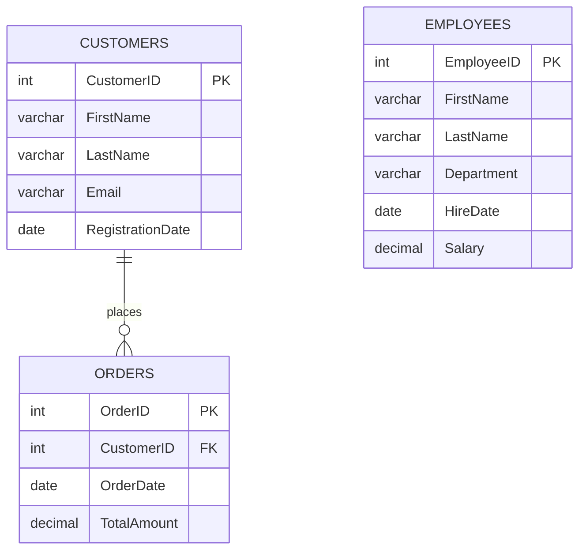
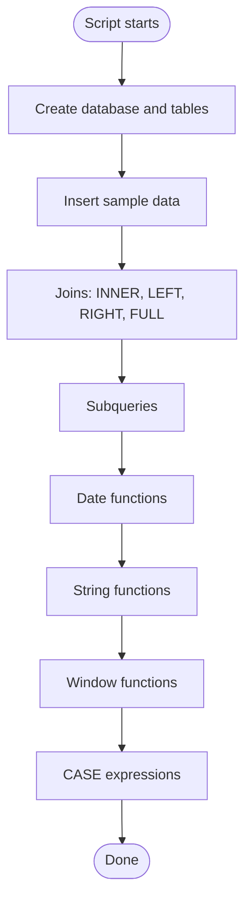

<div align="center">

```
██████╗  █████╗ ████████╗ █████╗
██╔══██╗██╔══██╗╚══██╔══╝██╔══██╗
██║  ██║███████║   ██║   ███████║
██║  ██║██╔══██║   ██║   ██╔══██║
██████╔╝██║  ██║   ██║   ██║  ██║
╚═════╝ ╚═╝  ╚═╝   ╚═╝   ╚═╝  ╚═╝

████████╗██████╗  █████╗ ███╗   ██╗███████╗███████╗ ██████╗ ██████╗ ███╗   ███╗███████╗██████╗
╚══██╔══╝██╔══██╗██╔══██╗████╗  ██║██╔════╝██╔════╝██╔═══██╗██╔══██╗████╗ ████║██╔════╝██╔══██╗
   ██║   ██████╔╝███████║██╔██╗ ██║███████╗█████╗  ██║   ██║██████╔╝██╔████╔██║█████╗  ██████╔╝
   ██║   ██╔══██╗██╔══██║██║╚██╗██║╚════██║██╔══╝  ██║   ██║██╔══██╗██║╚██╔╝██║██╔══╝  ██╔══██╗
   ██║   ██║  ██║██║  ██║██║ ╚████║███████║██║     ╚██████╔╝██║  ██║██║ ╚═╝ ██║███████╗██║  ██║
   ╚═╝   ╚═╝  ╚═╝╚═╝  ╚═╝╚═╝  ╚═══╝╚══════╝╚═╝      ╚═════╝ ╚═╝  ╚═╝╚═╝     ╚═╝╚══════╝╚═╝  ╚═╝
```

[](https://git.io/typing-svg)


</div>

## 🧭 Table of Contents

[Overview](#-project-overview) • [Objective](#-objective) • [Database Design](#-database-design) • [Table Reference](#-table-reference) • [Features](#-features) • [Query Catalog](#-query-catalog) • [Script Flow](#-script-flow) • [Example Output](#-example-output) • [Video](#-video) • [Skills Demonstrated](#-skills-demonstrated) • [Assumptions](#-assumptions) • [Known Behaviors](#-known-behaviors--notes) • [Getting Started](#-getting-started) • [Project Structure](#-project-structure) • [Tech Stack](#-tech-stack)

---

## 📌 Project Overview

**DATA TRANSFORMER** is an advanced **MySQL** practice project that simulates a **Corporate Data Analysis System**. It combines three business areas — **customer management**, **sales transaction processing**, and **employee performance data** — and then reshapes that raw data into reporting-ready results using the most important intermediate-to-advanced SQL techniques: **joins**, **subqueries**, **date and string functions**, **window functions**, and **`CASE` expressions**.

<div align="center">

| 🔗 Joins | 🧩 Subqueries | 📅 Date Functions | 🔤 String Functions | 🪟 Window Functions | 🏷️ CASE Logic |
|:---:|:---:|:---:|:---:|:---:|:---:|
| INNER, LEFT, RIGHT, FULL | Above-average filters | `YEAR` `MONTH` `DATEDIFF` `DATE_FORMAT` | `CONCAT` `REPLACE` `UPPER` `LOWER` `TRIM` | `SUM() OVER` `RANK() OVER` | Discounts & salary bands |

</div>

> Built as a **hands-on advanced SQL practice project** (Project 2 — *Data Transformer*).
> *"Take raw tables, apply the right transformation, get answers."*

---

## 🎯 Objective

Strengthen practical SQL skills by writing the 17 queries a real data analyst reaches for every day — combining tables, filtering against computed values, cleaning messy text, working with dates, ranking and accumulating rows, and categorising values with conditional logic.

Concepts demonstrated:

- **Joins** — `INNER`, `LEFT`, `RIGHT`, and an emulated `FULL OUTER JOIN` (via `UNION`) to combine `customers` and `orders`
- **Subqueries** — comparing each row against a computed average (`AVG`) to find above-average orders and salaries
- **Date manipulation** — extracting year/month, measuring day differences from today, and formatting dates for humans
- **String manipulation** — concatenating names, replacing text, changing case, and trimming stray whitespace
- **Window functions** — a running total with `SUM() OVER` and rankings with `RANK() OVER`
- **`CASE` expressions** — assigning discount tiers to orders and salary categories to employees

---

## 🧱 Database Design



**How it fits together:** one **customer** can place many **orders** (a one-to-many relationship enforced by a foreign key). The **employees** table is intentionally standalone — it supports the salary-focused queries (subquery, string functions, and `CASE` categorisation) without needing a join.

---

## 🗂️ Table Reference

| Table | Primary Key | Foreign Keys | Rows | Purpose |
|---|---|---|:---:|---|
| `customers` | `CustomerID` | — | 6 | Customer name, email, and registration date |
| `orders` | `OrderID` | `CustomerID` → `customers` | 7 | Sales transactions with date and total amount |
| `employees` | `EmployeeID` | — | 6 | Staff details with department, hire date, and salary |

**Data types at a glance**

- Money columns (`TotalAmount`, `Salary`) use `DECIMAL(10, 2)` to avoid floating-point rounding errors
- Dates use the `DATE` type so date functions work directly on them
- Names, emails, and departments use `VARCHAR`

---

## ✨ Features

**🔗 Combining Tables**
- Four join styles show exactly how matched and unmatched rows behave
- `FULL OUTER JOIN` is emulated with `LEFT JOIN ... UNION ... RIGHT JOIN` because MySQL has no native support

**🧩 Smart Filtering**
- Find customers who placed an order **above the average order value**
- Find employees earning **above the average salary**

**📅 Date Handling**
- Split dates into **year** and **month**
- Calculate **days elapsed** between an order and today
- Format dates as `DD-MMM-YYYY` (e.g. `01-Jul-2023`)

**🔤 Text Cleaning**
- Build **full names**, swap text, switch **upper/lower case**, and **trim** extra spaces from emails

**🪟 Analytics**
- A **running total** of sales over time
- A **rank** of orders from highest to lowest value

**🏷️ Business Rules**
- Assign **discount tiers** to orders and **High / Medium / Low** bands to salaries

---

## 📚 Query Catalog

All 17 tasks from the project brief, in the order they appear in the script.

### 🔗 Joins

| # | Task | Technique |
|:---:|---|---|
| 1 | Orders with customer details (only where orders exist) | `INNER JOIN` |
| 2 | All customers and their orders, if any | `LEFT JOIN` |
| 3 | All orders and their customers, if any | `RIGHT JOIN` |
| 4 | All customers and all orders, regardless of match | `LEFT JOIN` `UNION` `RIGHT JOIN` |

```sql
SELECT c.CustomerID, c.FirstName, c.LastName, o.OrderID, o.OrderDate, o.TotalAmount
FROM customers c
INNER JOIN orders o ON c.CustomerID = o.CustomerID;
```

### 🧩 Subqueries

| # | Task | Technique |
|:---:|---|---|
| 5 | Customers with an order above the average order amount | `IN`-style filter with `SELECT AVG(...)` subquery + `DISTINCT` |
| 6 | Employees paid above the average salary | Scalar subquery in `WHERE` |

```sql
SELECT * FROM employees
WHERE Salary > (SELECT AVG(Salary) FROM employees);
```

### 📅 Date Functions

| # | Task | Technique |
|:---:|---|---|
| 7 | Extract year and month from `OrderDate` | `YEAR()`, `MONTH()` |
| 8 | Days between order date and today | `DATEDIFF(CURDATE(), OrderDate)` |
| 9 | Readable date format | `DATE_FORMAT(OrderDate, '%d-%b-%Y')` |

### 🔤 String Functions

| # | Task | Technique |
|:---:|---|---|
| 10 | Full name from first and last name | `CONCAT(FirstName, ' ', LastName)` |
| 11 | Replace `John` with `Jonathan` | `REPLACE(FirstName, 'John', 'Jonathan')` |
| 12 | Uppercase first name, lowercase last name | `UPPER()`, `LOWER()` |
| 13 | Remove extra spaces from emails | `TRIM(Email)` |

### 🪟 Window Functions

| # | Task | Technique |
|:---:|---|---|
| 14 | Running total of order amounts | `SUM(TotalAmount) OVER (ORDER BY OrderDate, OrderID)` |
| 15 | Rank orders by amount | `RANK() OVER (ORDER BY TotalAmount DESC)` |

### 🏷️ CASE Expressions

| # | Task | Rule |
|:---:|---|---|
| 16 | Discount per order | `> 1000` → 10% • `> 500` → 5% • otherwise 0% |
| 17 | Salary category per employee | `>= 70000` → High • `>= 50000` → Medium • otherwise Low |

```sql
SELECT OrderID, TotalAmount,
       CASE
           WHEN TotalAmount > 1000 THEN '10% Discount'
           WHEN TotalAmount > 500  THEN '5% Discount'
           ELSE '0% Discount'
       END AS Discount
FROM orders;
```

---

## 🌊 Script Flow



| Step | Stage | Description |
|:---:|---|---|
| 1 | **Setup** | Create the `data_transformer` database and select it |
| 2 | **Schema** | Create `customers`, `orders` (with foreign key), and `employees` |
| 3 | **Seed** | Insert 6 customers, 7 orders, and 6 employees |
| 4 | **Join** | Combine customers and orders four different ways |
| 5 | **Filter** | Use subqueries to compare rows against averages |
| 6 | **Transform** | Apply date and string functions to reshape values |
| 7 | **Analyse** | Add running totals and rankings with window functions |
| 8 | **Classify** | Use `CASE` to label discounts and salary bands |

---

## 🎬 Example Output

<details open>
<summary><b>▶ Join comparison — same two tables, four results</b></summary>

| Join Type | Rows Returned | What it shows |
|---|:---:|---|
| `INNER JOIN` | 7 | Only customers who have orders |
| `LEFT JOIN` | 8 | Every customer — **Robert Lee** appears with `NULL` order details |
| `RIGHT JOIN` | 7 | Every order with its customer (all orders have a customer) |
| `FULL` (via `UNION`) | 8 | Every customer and every order, merged without duplicates |

</details>

<details open>
<summary><b>▶ LEFT JOIN — customers with and without orders</b></summary>

```
+------------+-----------+----------+---------+-------------+
| CustomerID | FirstName | LastName | OrderID | TotalAmount |
+------------+-----------+----------+---------+-------------+
|          1 | John      | Doe      |     101 |      150.50 |
|          1 | John      | Doe      |     103 |     1200.00 |
|          2 | Jane      | Smith    |     102 |      200.75 |
|          2 | Jane      | Smith    |     107 |      600.00 |
|          3 | Michael   | Brown    |     104 |      750.00 |
|          4 | David     | Wilson   |     105 |      450.00 |
|          5 | Sarah     | Taylor   |     106 |     1500.00 |
|          6 | Robert    | Lee      |    NULL |        NULL |
+------------+-----------+----------+---------+-------------+
```

</details>

<details open>
<summary><b>▶ Subquery — customers with an above-average order (average ≈ 693.04)</b></summary>

```
+------------+-----------+----------+
| CustomerID | FirstName | LastName |
+------------+-----------+----------+
|          1 | John      | Doe      |
|          3 | Michael   | Brown    |
|          5 | Sarah     | Taylor   |
+------------+-----------+----------+
```

</details>

<details open>
<summary><b>▶ Date functions — year, month, and formatted date</b></summary>

```
+---------+------------+-----------+------------+---------------+
| OrderID | OrderDate  | OrderYear | OrderMonth | FormattedDate |
+---------+------------+-----------+------------+---------------+
|     101 | 2023-07-01 |      2023 |          7 | 01-Jul-2023   |
|     102 | 2023-07-03 |      2023 |          7 | 03-Jul-2023   |
|     103 | 2023-07-05 |      2023 |          7 | 05-Jul-2023   |
|     104 | 2023-08-10 |      2023 |          8 | 10-Aug-2023   |
|     105 | 2023-09-15 |      2023 |          9 | 15-Sep-2023   |
|     106 | 2023-10-20 |      2023 |         10 | 20-Oct-2023   |
|     107 | 2023-11-25 |      2023 |         11 | 25-Nov-2023   |
+---------+------------+-----------+------------+---------------+
```

</details>

<details open>
<summary><b>▶ String functions — TRIM cleans the padded emails</b></summary>

```
+------------+------------------------+----------------------+
| CustomerID | Email                  | CleanEmail           |
+------------+------------------------+----------------------+
|          1 |  john.doe@email.com    | john.doe@email.com   |
|          4 |  david@email.com       | david@email.com      |
+------------+------------------------+----------------------+
(customers 2, 3, 5, 6 were already clean and are unchanged)
```

</details>

<details open>
<summary><b>▶ Window functions — running total and rank</b></summary>

```
+---------+------------+-------------+--------------+-----------+
| OrderID | OrderDate  | TotalAmount | RunningTotal | OrderRank |
+---------+------------+-------------+--------------+-----------+
|     101 | 2023-07-01 |      150.50 |       150.50 |         7 |
|     102 | 2023-07-03 |      200.75 |       351.25 |         6 |
|     103 | 2023-07-05 |     1200.00 |      1551.25 |         2 |
|     104 | 2023-08-10 |      750.00 |      2301.25 |         3 |
|     105 | 2023-09-15 |      450.00 |      2751.25 |         5 |
|     106 | 2023-10-20 |     1500.00 |      4251.25 |         1 |
|     107 | 2023-11-25 |      600.00 |      4851.25 |         4 |
+---------+------------+-------------+--------------+-----------+
```

*(The two window queries are separate in the script; they are shown side by side here for readability.)*

</details>

<details open>
<summary><b>▶ CASE — discount tiers and salary categories</b></summary>

| OrderID | TotalAmount | Discount |
|:---:|---:|---|
| 101 | 150.50 | 0% Discount |
| 102 | 200.75 | 0% Discount |
| 103 | 1200.00 | 10% Discount |
| 104 | 750.00 | 5% Discount |
| 105 | 450.00 | 0% Discount |
| 106 | 1500.00 | 10% Discount |
| 107 | 600.00 | 5% Discount |

| Employee | Salary | SalaryCategory |
|---|---:|---|
| Mark Johnson | 50000.00 | Medium |
| Susan Lee | 55000.00 | Medium |
| David Brown | 75000.00 | High |
| John Smith | 35000.00 | Low |
| Robert Wilson | 90000.00 | High |
| Priya Shah | 45000.00 | Low |

</details>

---

## 🎥 Video

Video Link : https://drive.google.com/drive/folders/1cPZBKBEs1actTUuvDB6t51DXOl9Nnzyi?usp=sharing

---

## 🎯 Skills Demonstrated

<div align="center">


</div>

- Combining related tables with inner, outer, and emulated full joins
- Writing subqueries that compare each row to a computed aggregate
- Cleaning and reshaping data with built-in date and string functions
- Using `OVER (...)` to calculate running totals and rankings without collapsing rows
- Encoding business rules (discounts, salary bands) directly in SQL with `CASE`

---

## 📋 Assumptions

The project brief asks for assumptions to be documented. These are the ones made:

- **Extended sample data:** the brief shows only two sample rows per table. The script uses **6 customers, 7 orders, and 6 employees** so the joins, subqueries, rankings, and categories produce meaningful results.
- **A customer with no orders:** customer `6` (Robert Lee) was added on purpose so that `LEFT JOIN` and the emulated `FULL OUTER JOIN` visibly differ from `INNER JOIN`.
- **Messy emails on purpose:** customers `1` and `4` have leading and trailing spaces in their email so that `TRIM()` has something to clean.
- **Salary bands:** the brief says only "high, medium, or low". The thresholds used are **`>= 70000` High**, **`>= 50000` Medium**, and everything below **Low**.
- **Discount tiers:** taken from the brief — **above 1000 → 10%**, **above 500 → 5%**, otherwise 0%. Because the comparison is strict (`>`), an order of exactly `1000.00` would receive the 5% tier.
- **Running total order:** orders are accumulated by `OrderDate`, with `OrderID` as a tiebreaker so the result is deterministic.
- **Full outer join:** MySQL has no `FULL OUTER JOIN` keyword, so it is emulated with `LEFT JOIN UNION RIGHT JOIN`.

---

## 📝 Known Behaviors & Notes

A few honest notes for anyone running or extending this script:

- **Window functions need MySQL 8.0+:** `SUM() OVER` and `RANK() OVER` fail on MySQL 5.7 and earlier.
- **Query 8 changes every day:** `DATEDIFF(CURDATE(), OrderDate)` is measured against the current date, so the `Daysdifference` values grow daily and will differ from run to run.
- **`TRIM`, `REPLACE`, `UPPER`, and `LOWER` only change the displayed result:** they are used inside `SELECT`, so the stored data is untouched. To permanently clean the emails, run `UPDATE customers SET Email = TRIM(Email);`.
- **`REPLACE` is case-sensitive and exact:** it only matches `John` as written. In the sample data, only employee `4` (John Smith) is affected, becoming `Jonathan`.
- **The discount query labels, it doesn't calculate:** it returns text like `10% Discount` but does not compute the reduced price. Multiply `TotalAmount` by `0.90` / `0.95` if you need the discounted amount.
- **`RANK()` leaves gaps on ties:** all order amounts are unique here, so ranks are 1–7, but two equal amounts would share a rank and skip the next number. Use `DENSE_RANK()` if you want no gaps.
- **Table name case:** the running-total query writes `FROM Orders` while the table was created as `orders`. This works on Windows and macOS, but on case-sensitive Linux installations (`lower_case_table_names = 0`) it raises *Table doesn't exist*. Use lowercase `orders` everywhere to be safe.
- **The script is not re-runnable as-is:** `CREATE TABLE` has no `IF NOT EXISTS` and there are no `DROP TABLE` statements, so a second run fails with *table already exists*. Drop the database first with `DROP DATABASE data_transformer;`.
- **`Email` is not `UNIQUE`:** nothing stops duplicate customer emails; add a `UNIQUE` constraint if the data should be clean by design.
- **The `employees` table has no relationship to the others:** it is a standalone dataset, so no join is possible between employees and orders.

---

## 🚀 Getting Started

### Prerequisites

- [MySQL 8.0+](https://dev.mysql.com/downloads/) (required for window functions)
- A SQL client: MySQL Workbench, DBeaver, phpMyAdmin, or the `mysql` command-line client

### Installation

```bash
git clone https://github.com/<your-username>/data-transformer.git
cd data-transformer
```

### Usage

**Option 1 — Command line**

```bash
mysql -u root -p < Data-transformer.sql
```

**Option 2 — MySQL Workbench / DBeaver**

1. Open `Data-transformer.sql`
2. Run the setup section first (database, tables, and inserts)
3. Execute each `SELECT` one at a time and compare the result grid with the examples above

> 💡 **Tip:** Run queries individually (select the statement, then press `Ctrl + Enter` in Workbench) so each result grid stays on screen instead of only the last one.

---

## 📁 Project Structure

```
data-transformer/
├── Data-transformer.sql        # Schema, sample data, and all 17 queries
├── PR-2-Data-Transformer.pdf   # Original project brief
└── README.md                   # Project documentation
```

---

## 🛠️ Tech Stack

- **Database:** MySQL 8.0+
- **Language:** SQL (DDL + DML + DQL)
- **Concepts demonstrated:** inner / left / right / full outer joins, subqueries, date functions, string functions, window functions (`SUM OVER`, `RANK OVER`), `CASE` expressions
